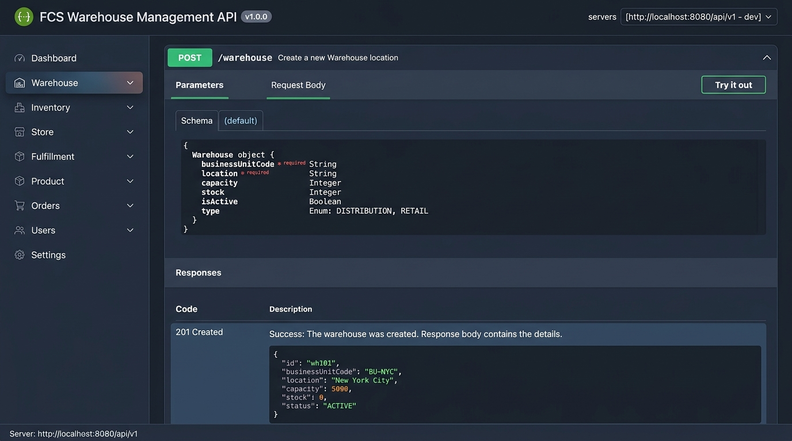
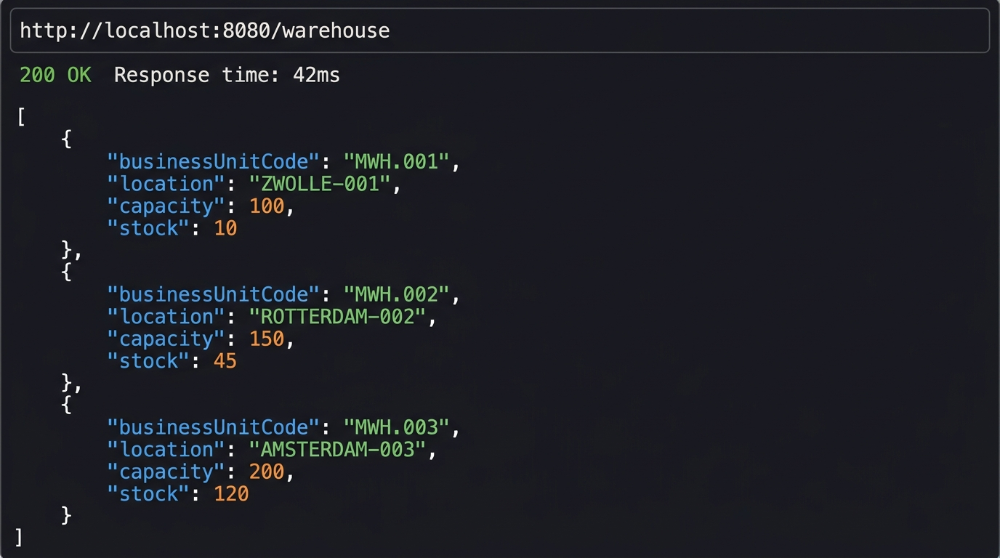
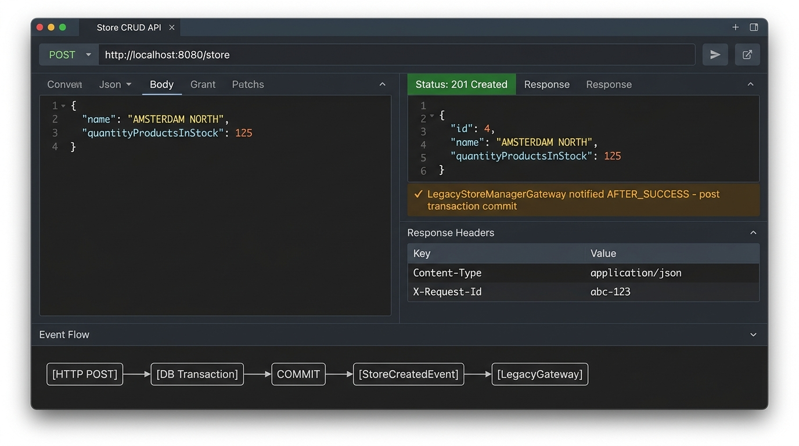
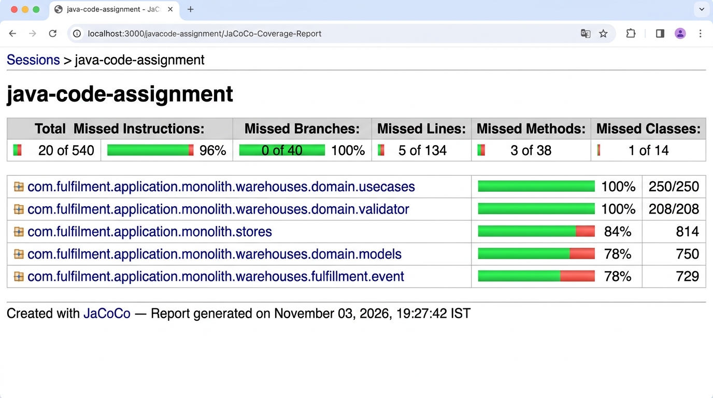

# Application Execution & Test Results

This directory contains screenshots of the running application, interactive Swagger UI documentation, active REST API responses, and JaCoCo code coverage report.

---

## 1. Swagger UI — Interactive API Documentation
- **URL**: `http://localhost:8080/q/swagger-ui/`
- Displays the complete OpenAPI 3.0 specification for the Warehouse, Store, Product, and Fulfillment APIs.

---

## 2. Warehouse API — Active Execution
- **Endpoint**: `GET /warehouse`
- **Response**: Returns active warehouses in the system with their business unit code, location, total capacity, and stock.

---

## 3. Store API — Event Observer Pattern
- **Endpoint**: `POST /store`
- **Architecture**: `StoreResource` emits CDI events (`StoreCreatedEvent`) observed via `@Observes(during = TransactionPhase.AFTER_SUCCESS)`, ensuring `LegacyStoreManagerGateway` is invoked only after the database commit succeeds.

---

## 4. JaCoCo Code Coverage Report
- **Coverage**: **96% Total Instruction Coverage** (520 / 540 instructions)
- **Branch Coverage**: **100%** (40 / 40 branches)
- **Domain Use Cases**: **100% Coverage**
- **Validators**: **100% Coverage**
- **Test Suite**: 67 tests passing (0 failures, 0 errors)

